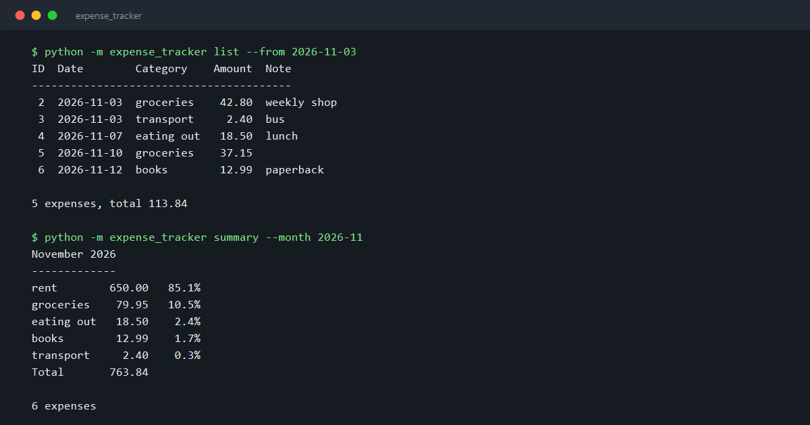

# Expense Tracker CLI

A modular command-line expense tracker with monthly reports and CSV export.

> **Status:** complete. Passed its quality review on 2026-11-18 (version 1.0.1).

## Demo



More images are in `docs/media/`: the full demo session ([demo.png](docs/media/demo.png)) and the test run with coverage ([tests.png](docs/media/tests.png)). They show the real output of `python scripts/demo.py` and `pytest`. The project has no hosted demo, because it is a command-line tool.

## Core focus

Clean, modular, object-oriented code for a small but complete application: three separate layers (command line, domain logic, storage), each tested on its own.

## Skills demonstrated

- Python (standard library only at run time)
- Object-oriented design with separated layers
- Unit testing with `pytest` (201 tests, coverage enforced)
- Git version control with small, focused commits
- Command-line interface design

## Quick start

You need Python 3.11 or newer. Run these in the project folder.

1. Create a virtual environment:

   ```bash
   python -m venv .venv
   ```

2. Activate it. The command depends on your system:

   | System and shell | Command |
   |---|---|
   | Windows, PowerShell | `.venv\Scripts\Activate.ps1` |
   | Windows, Command Prompt | `.venv\Scripts\activate.bat` |
   | Windows, Git Bash | `source .venv/Scripts/activate` |
   | macOS or Linux | `source .venv/bin/activate` |

3. Install and run:

   ```bash
   pip install -e ".[dev]"
   ```

   ```bash
   python -m expense_tracker --help
   ```

### Run with Docker instead

If you have Docker, you do not need Python. Put the command after the service name:

```bash
docker compose run --rm expense-tracker add 12.50 food --note lunch
```

```bash
docker compose run --rm expense-tracker summary
```

The expenses are kept in a Docker volume named `expense-data`, so they stay between runs. To get a CSV file out of the container, add `-v "$PWD:/out"` after `run` and export to `/out/expenses.csv`.

### Commands

| Command | What it does | Example |
|---|---|---|
| `add AMOUNT CATEGORY` | Records an expense. Options: `--date YYYY-MM-DD` (default: today), `--note TEXT`. | `python -m expense_tracker add 12.50 food --note lunch` |
| `list` | Shows expenses, oldest first, with a total. Filters: `--category`, `--from`, `--to`. | `python -m expense_tracker list --category food --from 2026-11-01` |
| `summary` | Shows the totals per category for one month. Option: `--month YYYY-MM` (default: this month). | `python -m expense_tracker summary --month 2026-11` |
| `export CSV_FILE` | Writes expenses to a CSV file. Takes the same filters as `list`. | `python -m expense_tracker export november.csv --to 2026-11-30` |

### Where the data is kept

The expenses are kept in one JSON file. The application picks the file in this order:

1. the `--file PATH` option (placed before the command),
2. the `EXPENSE_TRACKER_FILE` environment variable,
3. `~/.expense_tracker/expenses.json`.

To try the application without touching your own data, run `python scripts/demo.py`. It uses a temporary file.

## How it works

```
 cli.py      reads arguments, prints results        (argparse)
    |
 domain.py   Expense, ExpenseFilter, ExpenseTracker (rules only: no files, no printing)
    |
 storage.py  JsonExpenseRepository                  (one JSON file)
 export.py   CSV export
 config.py   decides where the data file is
```

- **Domain layer** (`domain.py`): an `Expense` is immutable and always valid. Amounts are `Decimal` values with two decimal places, so sums are exact. `ExpenseTracker` offers the operations (add, list, monthly summary) and talks to storage only through the small `ExpenseRepository` interface.
- **Storage layer** (`storage.py`): `JsonExpenseRepository` implements that interface. It writes to a temporary file and then replaces the real file in one step, so a failed write cannot leave half a file. A damaged file gives a clear error and is never overwritten.
- **Command-line layer** (`cli.py`): turns arguments into calls on the tracker and formats the results. It contains no rules.
- Because the layers are separate, the domain tests run against an in-memory repository, and the storage could be swapped (for example for SQLite) without changing the domain.

The design choices are explained in [docs/decisions.md](docs/decisions.md).

## Results

Measured on Windows with Python 3.13 on 2026-11-18:

| Check | Result |
|---|---|
| Tests | 201 pass |
| Coverage, domain logic (`domain.py`) | 100% (requirement: at least 80%) |
| Coverage, whole package | 98% (lines and branches); `pytest` fails below 90% |
| Lint (`ruff check .`) | passes |
| Run-time dependencies | none (standard library only) |

## Tests

```bash
ruff check .
```

```bash
pytest
```

```bash
python scripts/validate_portfolio.py
```

`pytest` also prints the coverage report. The tests use temporary folders and never touch your own data file or the network.

## Limitations

- One currency. Amounts are plain numbers with two decimal places and no currency symbol.
- Amounts are written with digits and a decimal point (`12.50`). Scientific notation (`1e2`) and thousands separators (`1,000`) are refused, and the largest amount is 999,999,999.99.
- Expenses cannot be edited or deleted from the command line yet.
- The whole file is read and rewritten on every command. That is fine for personal use, but not for very large files.
- It is made for one user at a time. Two commands writing at the same moment could lose one of the changes.

## Changes

**1.0.1** (2026-11-18), after the quality review:

- Very large amounts (29 digits or more, or `1e30`) caused a `decimal.InvalidOperation` crash. Amounts are now limited to 999,999,999.99 and anything larger gives a clear error, from the command line and from the data file.
- A data file that is not UTF-8 caused a `UnicodeDecodeError` crash. It is now reported as a damaged file and left unchanged.
- On Windows, Greek and other non-Latin text caused a `UnicodeEncodeError` crash when the output was redirected to a file or a pipe, after the expense had already been saved. The output is now always UTF-8.
- Amounts in scientific notation (`1e2`) are refused.
- Each of these has a test that failed before the fix.

## Next steps

- `edit` and `delete` commands.
- Monthly budgets per category, with a warning when one is exceeded.
- Importing expenses from a CSV file.

## License

MIT. See [LICENSE](LICENSE).
